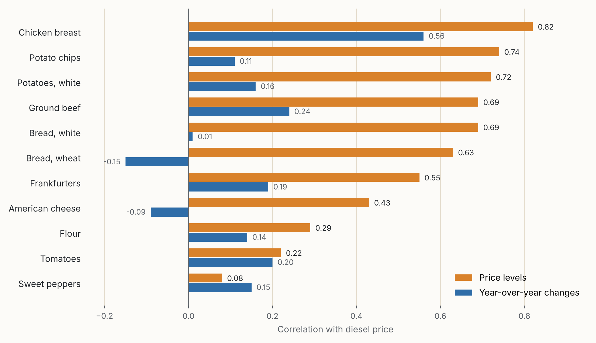

# Gas & Groceries: Outside Influences on Operating Costs at JR's Chi Kitchen

How U.S. fuel and grocery prices have changed since 2015, whether they move together, and what that means for a small food truck business.

**DSC 680 Applied Data Science · Bellevue University · James Robinson · November 2026**

---

## Business Problem

JR's Chi Kitchen is an Omaha food truck serving Chicago-style hot dogs and pizza. Its two biggest variable costs are fuel and ingredients. When either one jumps, the owner has to decide whether to raise menu prices, change the menu, switch suppliers, or absorb thinner margins.

### Research Questions

1. How have U.S. grocery and gasoline prices changed from 2015 to 2026, and over the last five years?
2. Is there a measurable relationship between gasoline prices and grocery prices?
3. Does any particular grocery item track fuel prices directly?

## Key Findings

- **Costs are much higher than in 2015.** Diesel went from $2.96 to $5.08 a gallon (about $42 more per 20-gallon fill-up), and ground beef from $4.68 to $7.12 a pound. Most of the increase came in 2021–2022 and never came back down.
- **Fuel is the most volatile cost.** Diesel averaged a 54% year-over-year increase in 2022 and was up 63% year over year in May 2026.
- **The most recent year is mixed.** Fuel, tomatoes and ground beef rose, while potatoes, chips, cheese, flour and chicken breast fell slightly.
- **Fuel and food are not directly linked.** Raw prices look strongly correlated (0.6–0.8), but that reflects shared inflation. Once the trend is removed by comparing year-over-year changes, 10 of 11 ingredients fall under 0.25. Only chicken breast keeps a moderate link to diesel (0.56).



## Recommendations

- Budget for fuel spikes instead of assuming flat prices.
- Price menu items one at a time rather than raising everything.
- Build specials around ingredients that recently got cheaper (potatoes, cheese, chicken breast).
- Next step: add the business's own supplier prices, sales and fuel use to measure real margins.

## Data

- **U.S. Grocery and Gas Prices (2015–2026)** (Sama, Kaggle): U.S. national average monthly prices for 74 items across 12 categories, January 2015 through July 2026. 8,869 monthly records in three files (monthly, item summary, wide format).

The dataset is not included in this repo. Download it from Kaggle and place the three CSV files in a `Data/` folder next to the notebook.

## Methods

1. Converted date columns to datetime and dropped unneeded columns.
2. Split the data into fuel and grocery sets, then narrowed to 11 menu ingredients plus diesel and regular gasoline.
3. Measured long-run change (first 12-month average vs. last 12-month average) and year-over-year percent change.
4. Correlated fuel with each ingredient on both raw price levels and year-over-year changes, to separate shared inflation from a real relationship.

This is descriptive analysis. It explains how costs have behaved; it does not forecast prices.

## Limitations

- Prices are U.S. national averages, not the business's actual Omaha supplier costs.
- The frankfurter series ends in 2023 and sweet peppers in 2020; October 2025 is missing for every item.
- No sales, menu price or fuel use data, so margins can't be measured.
- Correlation shows a relationship, not causation.

## Repository Structure

```
├── README.md
├── gas_grocery_analysis.ipynb   # full analysis
├── Data/                        # place the Kaggle CSVs here (not included)
├── figures/                     # charts from the notebook
└── reports/                     # white paper and presentation (PDF, coming soon)
```

## How to Run

```bash
pip install pandas numpy matplotlib seaborn jupyterlab
jupyter lab gas_grocery_analysis.ipynb
```

## Tools

Python · pandas · NumPy · matplotlib · seaborn · Jupyter Lab

## References

- Sama, H. (n.d.). *US grocery and gas prices (2015–2026)* [Data set]. Kaggle.
